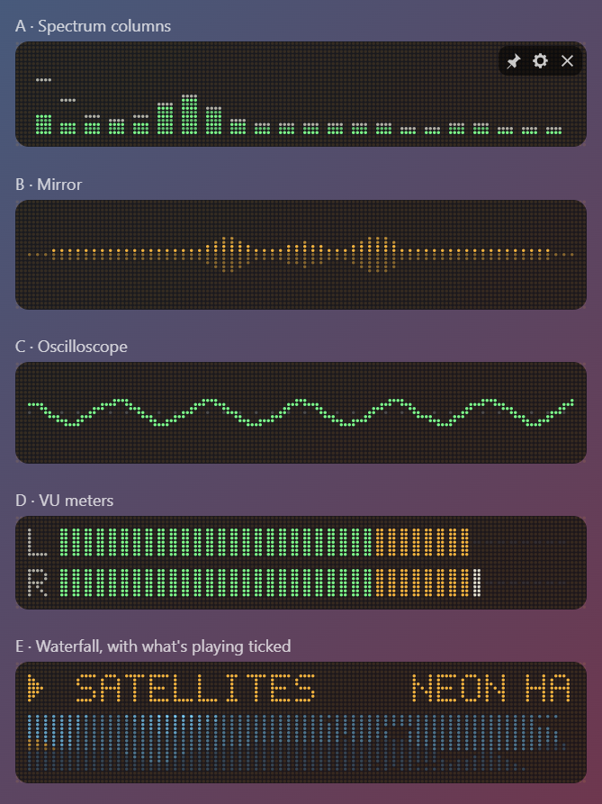
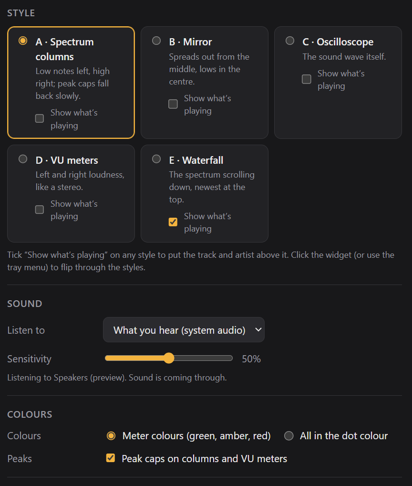

# Dot Visualiser

A dot-matrix music visualiser for Windows and macOS. It moves with whatever your computer is playing (Spotify, YouTube, games, anything) and goes quiet when nothing is. It's from the same family as [Dot Clock](https://github.com/slainbya-dotcom/dot-clock), Dot Timer, Dot Focus, Dot Calendar, Dot Sun, Dot Ticker, Dot Planner, Dot System, Dot Player, Dot Weather and Dot Dice.

## What it does

Pick one of five styles in settings, or click the widget to flip through them:

| Style | What it looks like |
|---|---|
| A · Spectrum columns | Low notes on the left, high on the right, green to amber to red, with peak caps that fall back slowly |
| B · Mirror | Spreads out from the middle, with the lows in the centre |
| C · Oscilloscope | The sound wave itself, scaled so quiet music still fills it |
| D · VU meters | Left and right loudness, like a hi-fi amplifier |
| E · Waterfall | The spectrum scrolling down, newest at the top |

Each style has its own **Show what's playing** tick box. When it's ticked, the track and artist scroll above the visualiser. It reads them the same way Dot Player does.

**Settings also include:**
- **Sensitivity:** how much sound it takes to light things up.
- **Sound source:** which sound to listen to (see below).
- **Colours:** meter colours, or everything in the dot colour.
- **Peak caps:** on or off.
- **Matching Dot Clock:** same width, dot size and colours.

## What it listens to

- **Windows:** "What you hear", which is whatever is going to your speakers or headphones. No permission is needed, and it follows you if you switch output. You can also choose a microphone or other input.
- **macOS:** apps can't simply listen to the computer's own sound, so it listens to a sound input. That's the microphone by default, which shows the room. To visualise the music itself:
  1. Install a free loopback driver such as [BlackHole](https://existential.audio/blackhole/).
  2. Send your sound through it, using a Multi-Output Device in Audio MIDI Setup so you can still hear it.
  3. Choose it in settings.

  macOS asks once for microphone permission.

Nothing is recorded or sent anywhere: the sound is analysed as it plays and thrown away.

## Where it lives

The widget doesn't take up a spot on the taskbar (or the Dock on a Mac). It sits in the **system tray** (the menu bar on a Mac) instead. Left-click the tray icon to bring the widget forward, and right-click it to show or hide the widget, go to the next style, open settings, move the widget to the centre of the screen, or quit.

## Building it yourself

See [BUILDING.md](BUILDING.md). The installer is called `Dot Visualiser_1.0.0_x64_en-US.msi`.

## Check out the Singular Widgets

[Dot Calendar](https://github.com/slainbya-dotcom/dot-Calendar)
[Dot Clipboard](https://github.com/slainbya-dotcom/dot-clipboard)
[Dot Clock](https://github.com/slainbya-dotcom/dot-clock)
[Dot Deck](https://github.com/slainbya-dotcom/dot-deck)
[Dot Dice](https://github.com/slainbya-dotcom/dot-dice)
[Dot Focus](https://github.com/slainbya-dotcom/dot-focus)
[Dot Launcher](https://github.com/slainbya-dotcom/dot-launcher)
[Dot List](https://github.com/slainbya-dotcom/dot-list)
[Dot Planner](https://github.com/slainbya-dotcom/dot-planner)
[Dot Player](https://github.com/slainbya-dotcom/dot-player)
[Dot Reader](https://github.com/slainbya-dotcom/dot-reader)
[Dot Sun](https://github.com/slainbya-dotcom/dot-sun)
[Dot System](https://github.com/slainbya-dotcom/dot-system)
[Dot Ticker](https://github.com/slainbya-dotcom/dot-ticker)
[Dot Timer](https://github.com/slainbya-dotcom/dot-timer)
[Dot Visualiser](https://github.com/slainbya-dotcom/dot-visualiser)
[Dot Weather](https://github.com/slainbya-dotcom/dot-weather)